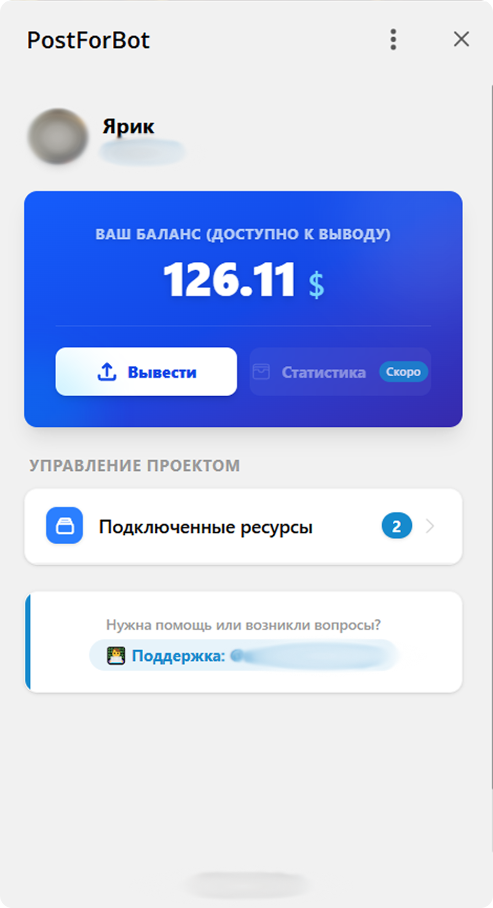
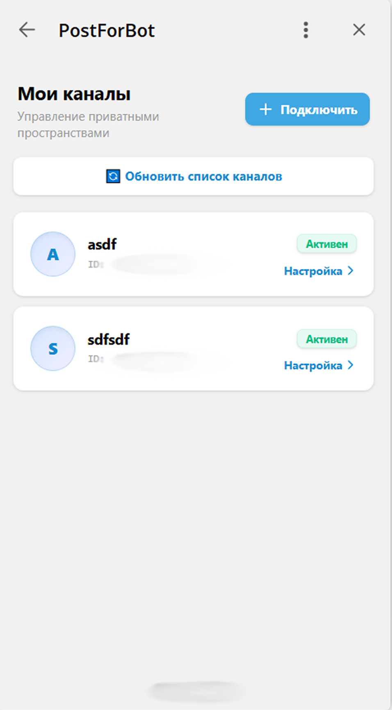
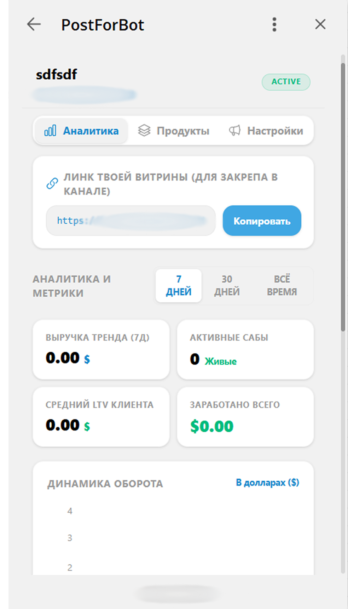
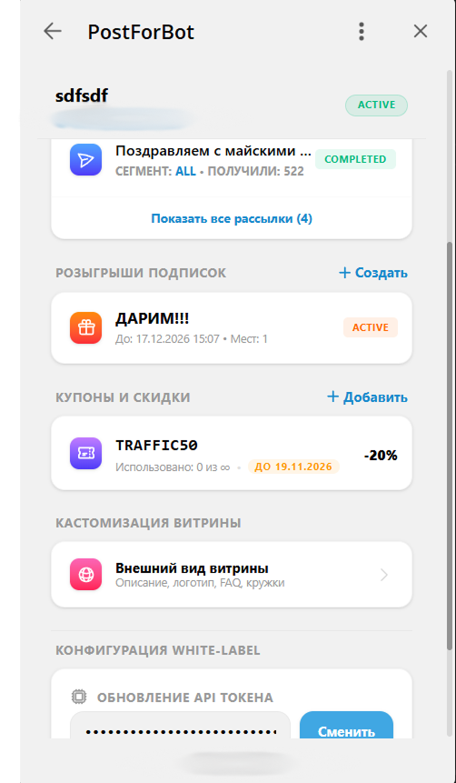
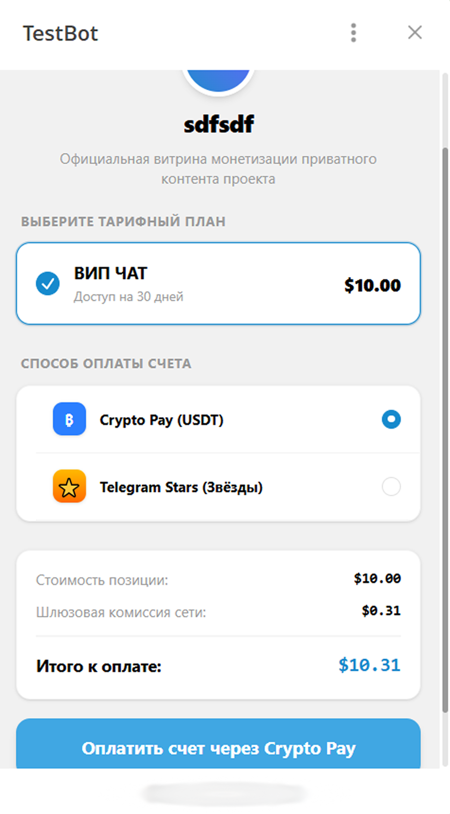
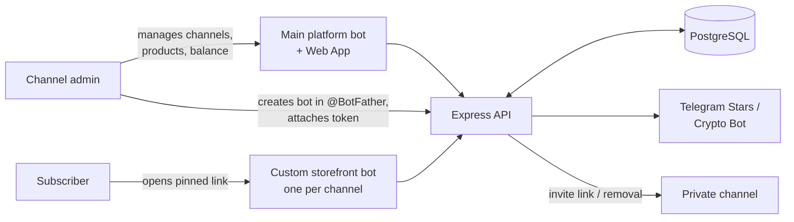
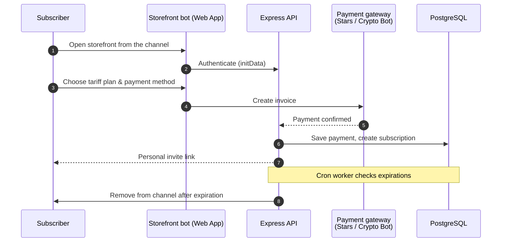
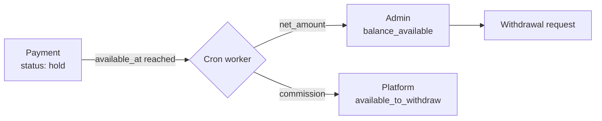
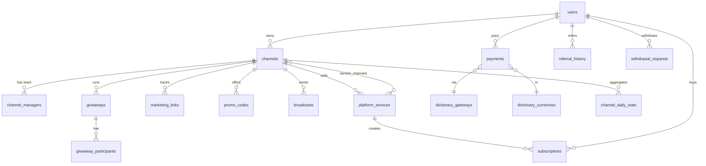

<div align="center">

# 💸 TG-SaaS

### Paid-subscription automation platform for Telegram channels

Monetize private channels with automated subscriptions, payments in **Telegram Stars** and **Crypto Bot**, and a native **Telegram Web App** for both channel owners and subscribers.


</div>

---

## 📑 Table of Contents

- [About](#about)
- [Screenshots](#screenshots)
- [Features](#features)
- [How It Works](#how-it-works)
- [Tech Stack](#tech-stack)
- [Database Design](#database-design)
- [Background Workers](#background-workers)
- [Getting Started](#getting-started)
- [Roadmap](#roadmap)
- [Author](#author)

---

## About

Channel admins who sell access to private Telegram channels usually do it by hand: collect payments, send invite links, remember who has to be removed. **TG-SaaS** automates the entire cycle:

1. a subscriber pays inside Telegram,
2. gets a personal invite link to the private channel,
3. is removed automatically when the subscription expires,
4. and the admin sees balances and earnings in a clean dashboard.

Everything runs inside Telegram and is built around **two kinds of bots**:

| Bot                                            | Who uses it    | Purpose                                                                                                                                                                        |
| ---------------------------------------------- | -------------- | ------------------------------------------------------------------------------------------------------------------------------------------------------------------------------ |
| 🛠️ **Main platform bot** (Web App)             | Channel admins | Connect channels, manage products, see analytics, check balance and withdraw funds                                                                                             |
| 🏪 **Custom storefront bot** (one per channel) | Subscribers    | The admin creates their own bot in @BotFather and attaches its token to a channel. The bot becomes the channel's branded **storefront** with tariff plans (e.g. 30-day access) |

The admin pins the storefront link in the channel, subscribers open it, pick a plan, pay and instantly get an invite link.

## Screenshots

<!-- Put your screenshots into docs/screenshots/ and adjust the file names. -->

### Admin side – main platform bot

|                  Profile & balance                   |                      My channels                      |                   Channel analytics                    |                   Channel settings                    |
| :--------------------------------------------------: | :---------------------------------------------------: | :----------------------------------------------------: | :---------------------------------------------------: |
|  |  |  |  |

### Subscriber side – channel storefront bot

|     Storefront with tariff plans & payment methods      |
| :-----------------------------------------------------: |
|  |

## Features

### Available now

- 🔐 **Secure authentication** – Telegram Web App `initData` is validated on the backend, no passwords
- 📺 **Channel connection** – admins attach their private channels and list them in the Web App
- 🤖 **Own bot per channel** – each channel gets its own branded storefront bot (token from @BotFather)
- 🏪 **Storefront** – subscribers choose a tariff plan (e.g. _VIP chat – 30 days – $10_) and a payment method
- 🧾 **Paid services** – subscriptions with a duration, price and currency
- 💳 **Payments** – **Telegram Stars** and **Crypto Bot** (USDT), with the gateway fee shown transparently in the order summary
- 🔗 **Automatic access control** – personal invite links on purchase, automatic removal after expiration
- 💰 **Admin balances** – separate _hold_ and _available_ balances, platform commission calculated per payment
- 📊 **Channel analytics** – revenue trend, active subscribers, average customer LTV, total earned and a turnover chart for 7 days / 30 days / all time
- 💼 **Admin wallet** – available balance and withdrawal requests
- ⏱️ **Cron workers** – expiration checks and hold release run in the background
- 🔄 **Robust API layer** – Axios interceptors and Vite proxy for smooth dev/prod data flow

### Schema-ready (planned)

The database is already designed for the next iterations:

| Feature                                                                     |          Status          |
| --------------------------------------------------------------------------- | :----------------------: |
| 🎁 Giveaways (prizes are services, random winners at `end_at`)              |      🚧 in progress      |
| 🤝 Referral program (two-sided: user subscriptions and admin turnover)      |        🗄️ schema         |
| 🏷️ Promo codes (percentage / fixed, usage limits, expiry)                   |      🚧 in progress      |
| 📢 Mass broadcasts with segment filters (all / active / expired / trials)   |        🗄️ schema         |
| 🏪 Custom storefronts (landing description, banner, video note, FAQ)        |        🗄️ schema         |
| 📦 Bundle plans (one service attached to several channels)                  |        🗄️ schema         |
| 🔥 Interactive warm-up funnels                                              |         💭 idea          |
| 👥 Team access (owner / administrator / operator with granular permissions) |        🗄️ schema         |
| 🎯 Marketing links with click and conversion tracking                       |        🗄️ schema         |
| 🌐 TON Connect payments                                                     |   🗄️ gateway reserved    |
| ⏰ Expiration reminders (3 days / 1 day before, after expiry)               | 🗄️ schema + job prepared |

## How It Works

### Platform overview



### Purchase flow



### Money flow

Payments land in the admin's **hold** balance first. After the hold period, a worker moves the net amount to the **available** balance and credits the platform commission (3% by default, configurable per user).



## Tech Stack

| Layer        | Technologies                                             |
| ------------ | -------------------------------------------------------- |
| **Frontend** | React, Vite, Tailwind CSS, Axios, Telegram Web App SDK   |
| **Backend**  | Node.js, Express.js, Telegram Bot API, node-cron         |
| **Database** | PostgreSQL (JSONB for localization, permissions and FAQ) |
| **Payments** | Telegram Stars, Crypto Bot                               |
| **Tools**    | Git, ngrok (HTTPS tunnel for local Web App testing)      |

## Database Design

A PostgreSQL schema of 20+ tables with foreign keys, partial indexes and localized dictionaries (`JSONB`). Full schema: [`database/design.sql`](database/design.sql).



**Highlights**

- **Dictionaries** for currencies (`USD`, `USDT`, `STARS`) and gateways – new payment methods need no schema changes
- **Hold / available** balance split for safe payouts
- **Partial indexes** on `subscriptions.expires_at`, `broadcasts.run_at` and `giveaways.end_at` for fast cron queries
- **Denormalized analytics** (`channel_customers`, `channel_daily_stats`) for quick dashboards
- **Service types:** `subscription`, `paid_chat`, `paid_post`, `donate`, with optional sale price and time window

## Background Workers

Scheduled with `node-cron`:

| Worker             | Schedule           | What it does                                                                                                                                   |
| ------------------ | ------------------ | ---------------------------------------------------------------------------------------------------------------------------------------------- |
| Subscription check | every 3 minutes    | Finds expired subscriptions and removes users from the private channel                                                                         |
| Hold release       | at 00:05 every day | Switches finished Stars payments from `hold` to `success`, moves funds from `balance_hold` to `balance_available`, credits platform commission |
| Reminders          | prepared           | Notifies users 3 days / 1 day before expiration                                                                                                |

All balance changes run inside a **database transaction**, so money is never left in a half-updated state.

## Getting Started

### Prerequisites

- Node.js 18+
- PostgreSQL 14+
- A Telegram bot token for the main platform bot from [@BotFather](https://t.me/BotFather)
- _(for testing storefronts)_ a second bot from @BotFather – in production every admin attaches their own bot token to each channel
- [ngrok](https://ngrok.com/) (Telegram Web Apps require HTTPS)

### 1. Clone the repository

```bash
git clone https://github.com/yakuya00/tg-saas-platform.git
cd tg-saas-platform
```

### 2. Set up the database

```bash
createdb web-platform
psql -d web-platform -f database/design.sql
```

### 3. Configure the backend

```bash
cd server
cp .env.example .env
```

Fill in the database connection, bot token, payment provider keys and URLs. All variables are listed in `.env.example`.

### 4. Install and run

```bash
# backend
cd server
npm install
npm run dev

# frontend (in another terminal)
cd client
npm install
npm run dev
```

### 5. Expose the Web App over HTTPS

```bash
ngrok http 5173
```

Set the generated HTTPS URL as the Web App URL of your bot in [@BotFather](https://t.me/BotFather).

## Roadmap

- [x] Telegram Stars payments
- [x] Crypto Bot payments
- [x] Subscription lifecycle with automatic removal
- [x] Hold / available balance system
- [ ] Expiration reminders
- [ ] Promo codes
- [ ] Referral program
- [ ] Giveaways
- [ ] Mass broadcasts with segment filters
- [ ] Custom storefronts and bundle plans
- [ ] Interactive warm-up funnels
- [ ] TON Connect payments

## Author

**Yaroslav Yakushev** – [@yakuya00](https://github.com/yakuya00)

[](https://linkedin.com/in/yaroslav-yakushev-6759a937a)

## 📄 License

<a href="LICENSE" alt="LICENSE"></a>
